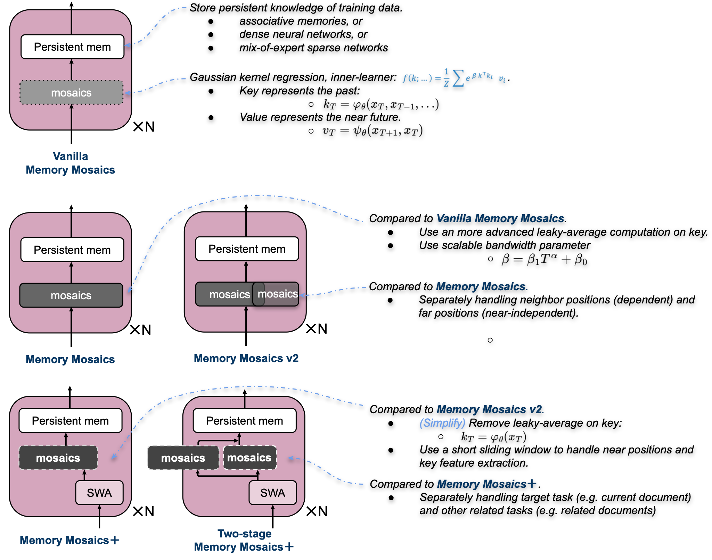

# Memory Mosaics

Memory Mosaics are networks of associative memories working in concert to achieve a
prediction task of interest. The goal of Memory Mosaics is to study how to build AI for the open-world. 
**AI for the open world requires a machine to learn a wide range of new tasks, using
fewer examples and less task-specific prior knowledge from human designers.**


**Latest News**
- [2026.10] Release source code of Memory Mosaics+ and Two-stage Memory Mosaics+ as in [Open-world AI: a tale of three requirements](https://arxiv.org/pdf/2610.20782), supporting consistent in-context learning (for the first time).
- [2026.10] "[Open-world AI: a tale of three requirements](https://arxiv.org/pdf/2610.20782)" frames open-world AI and derives three requirements: *rich representation*, *predictive disentanglement*, and *inference-time learning*. 
- [2026.10] Release source code of **Memory Mosaics v2** as in [Memory Mosaics at scale](https://proceedings.neurips.cc/paper_files/paper/2025/file/3767842e2ebee900236f534855aa2c36-Paper-Conference.pdf), featuring FSDP2, FlexAttention block-sparse masks, activation checkpointing, etc.
- [2025.09] "[Memory Mosaics at scale](https://proceedings.neurips.cc/paper_files/paper/2025/file/3767842e2ebee900236f534855aa2c36-Paper-Conference.pdf)" scales Memory Mosaics to 10B parameters and 1T training tokens, accepted by NeurIPS 2025 **Oral (top 0.36%)**.
- [2025.01] "[Memory Mosaics](https://proceedings.iclr.cc/paper_files/paper/2025/file/59c3ac496e6fe7be0c2c2b95014e2210-Paper-Conference.pdf)" is accepted by ICLR 2025.

<!-- **License**: This code is released under the [Apache-2.0 License](LICENSE.txt). -->

<p align="center">
  
  <br>
  <em>Memory Mosaics family</em>
</p>

| architecture | paper | code |
|---|---|---|
| Vanilla Memory Mosaics | [Memory Mosaics](https://proceedings.iclr.cc/paper_files/paper/2025/file/59c3ac496e6fe7be0c2c2b95014e2210-Paper-Conference.pdf) (ICLR 2025) | [`vanilla_memory_mosaics/`](vanilla_memory_mosaics) |
| Memory Mosaics v2 | [Memory Mosaics at scale](https://proceedings.neurips.cc/paper_files/paper/2025/file/3767842e2ebee900236f534855aa2c36-Paper-Conference.pdf) (NeurIPS 2025) | [`memory_mosaics_v2.yaml`](configs/mosaics/memory_mosaics_v2.yaml) |
| Memory Mosaics | [Open-world AI: a tale of three requirements](https://arxiv.org/pdf/2610.20782) (arXiv 2026)  | [`memory_mosaics.yaml`](configs/mosaics/memory_mosaics.yaml) |
| Memory Mosaics+ | [Open-world AI: a tale of three requirements](https://arxiv.org/pdf/2610.20782) (arXiv 2026) | [`memory_mosaics+.yaml`](configs/mosaics/memory_mosaics+.yaml) |
| Two-stage Memory Mosaics+ | [Open-world AI: a tale of three requirements](https://arxiv.org/pdf/2610.20782) (arXiv 2026) | [`two-stage_memory_mosaics+.yaml`](configs/mosaics/two-stage_memory_mosaics+.yaml) |


## Layout

```
configs/          one YAML per model, by family: mosaics/ transformer/ hybrid/ rnn/; sft/; debug.yaml
model/            common/ (shared layers), mosaics/, transformer/, rnn/ -- one folder per family
training/         training loop, FSDP/DDP, checkpointing
dataloader/       streaming, sharding, packing and resuming training data
inference/        KV-cache generation
cluster_corpus/   builds the corpus: normalize → embed → cluster → organize
tokenizer/        the Mistral-7B tokenizer (HuggingFace), the SFT chat format
launchers/        SLURM launcher
figure/           the architecture figure
vanilla_memory_mosaics/   the ICLR 2025 code (separate)
```

## Setup

Building the training corpus ([`cluster_corpus/`](cluster_corpus)) also needs FAISS,
installed for your machine. Install it **first**: conda's faiss-gpu brings its own numpy,
and conda-installing it over a pip-installed numpy leaves a broken mix of the two. Keep
the `>=1.13` pin: the requirements pull in numpy 2 (via scipy, matplotlib), and older
faiss-gpu builds, which conda may otherwise pick, are compiled for numpy 1.x.

```bash
conda create -n mm python=3.12 -y
conda activate mm
conda install -c pytorch -c nvidia "faiss-gpu>=1.13"   # or, CPU only: pip install faiss-cpu
pip install -r requirements.txt                        # keeps conda's numpy 2.x
huggingface-cli login     
```

## 1. Training data

Two ways to build training sequences, chosen by `data.loader` in a config:

- `pretrain`: documents packed in random order, the usual pretraining. Used by *Memory
  Mosaics v2*.
- `cluster`: documents are grouped into semantic clusters (k-means over document
  embeddings), and each training sequence is packed from the documents of one cluster,
  i.e. related tasks. Used by the *Open-world AI* configs.

`cluster_corpus/prepare.sh` builds the data for both; see
[`cluster_corpus/README.md`](cluster_corpus/README.md).

```bash
bash cluster_corpus/prepare.sh tiny   --go     # 50k Cosmopedia docs, k=20: minutes, smoke test only
bash cluster_corpus/prepare.sh simple --go     # full Cosmopedia, k=1200 (cluster-scale embedding job)
```

Output goes under `data_out/`:

- `normalized/<source>/`: the documents as JSONL (stage 1), read by the `pretrain` loader;
- `clustered_{tiny_k20,simple_k1200}/`: per-cluster JSONL plus `metadata_train.json` /
  `metadata_test.json` (held-out test clusters), read by the `cluster` loader.

The configs point at `data_out/normalized` and `data_out/clustered_simple_k1200`.

## 2. Training

Smoke test on one GPU:

```bash
torchrun --nproc_per_node 1 -m training.train config=configs/debug.yaml
```

A full run, single node:

```bash
torchrun --nproc_per_node 8 -m training.train config=configs/mosaics/two-stage_memory_mosaics+.yaml
```

Multi-node on SLURM. The launcher snapshots the code into the run directory, writes the
resolved config, and requeues the job on failure (it resumes from the latest checkpoint):

```bash
python -m launchers.slurm run name=two_stage_mmplus config=configs/mosaics/two-stage_memory_mosaics+.yaml \
    nodes=32 partition=<partition> account=<account>
```

Runs go to `dumps/<name>/` (set `DUMP_ROOT` for the launcher): `checkpoints/step_N/`,
`metrics.jsonl`, and `base_config.yaml`, the exact config that ran.

### Fine-tuning (SFT)

Fine-tuning continues a pretrained checkpoint with the same training code, chosen by
`data.loader: sft` in a config:

- `sft`: chat conversations, packed into sequences; the
  loss covers the assistant answers only.

The data is a directory of JSONL files, one conversation per line:

```json
{"messages": [{"role": "user", "content": "..."}, {"role": "assistant", "content": "..."}]}
```

`tools/prepare_metamath_sft_data.py` is an example of building SFT data.
```bash
python -m tools.prepare_metamath_sft_data --num_example 262144 --output data_out/metamath_sft_262k/train
```

A full run, single node:
```bash
torchrun --nproc_per_node 1 -m training.train config=configs/sft/metamath.yaml
```

The model (family, settings, tokenizer) comes from the pretrained checkpoint
(`continue_from.inherit_model: true`); keys under `model:` override it
(`attn_bias_type: doc_causal` keeps packed conversations separate).

For the two-stage models (Two-stage Memory Mosaics+, Two-stage Transformer+),
`model: {disable_cluster: true}` fine-tunes without the related-task memory: it is skipped
in the forward pass, and its weights stay unchanged. The setting is saved with the
fine-tuned model (`model.disable_cluster` in its `params.json`); set it to `false` there to
generate with the related-task memory.

## 3. Generation

`inference/generator.py` generates with a cache for every model in the repository:
prefill the prompt, then one token per step 

```bash
python -m inference.chat --model_path <checkpoint>
```

> `Generator.generate(...,attn_bias_type=...)` defaults to `causal`; 
> `inference.chat` passes the model's own mask type.

## Baselines

The baselines of *Open-world AI* train with the same code and data as the Mosaics
models, so a comparison isolates the memory:

| baseline | config | what it is |
|---|---|---|
| Transformer | [`transformer.yaml`](configs/transformer/transformer.yaml) | softmax attention with RoPE in every layer |
| Hybrid SWA | [`hybrid_swa.yaml`](configs/hybrid/hybrid_swa.yaml) | layers alternate: sliding-window attention (2k, RoPE) / full attention (no position encoding) |
| Hybrid DeltaNet | [`hybrid_deltanet.yaml`](configs/hybrid/hybrid_deltanet.yaml) | layers alternate: gated DeltaNet / full attention (no position encoding) |
| DeltaNet | [`deltanet.yaml`](configs/rnn/deltanet.yaml) | a recurrent model: every layer a gated DeltaNet |
| Transformer+, two-stage Transformer+ | in [`configs/mosaics/`](configs/mosaics) | Mosaics-like transformers. See [Open-world AI: a tale of three requirements](https://arxiv.org/pdf/2610.20782). |

## Reference

```
@article{zhang2026openworld,
  title={Open-world AI: a Tale of Three Requirements},
  author={Zhang, Jianyu and Bottou, L{\'e}on},
  journal={arXiv preprint arXiv:2610.20782},
  year={2026},
  url={https://arxiv.org/pdf/2610.20782}
}
@article{zhang2026memory,
  title={Memory Mosaics at scale},
  author={Zhang, Jianyu and Bottou, L{\'e}on},
  journal={Advances in Neural Information Processing Systems},
  volume={38},
  pages={38929--38956},
  year={2026}
}
@inproceedings{zhang2025memory,
  title={Memory mosaics},
  author={Zhang, Jianyu and Nolte, Niklas and Sadhukhan, Ranajoy and Chen, Beidi and Bottou, L{\'e}on},
  booktitle={International Conference on Learning Representations},
  volume={2025},
  pages={36412--36433},
  year={2025}
}
```
